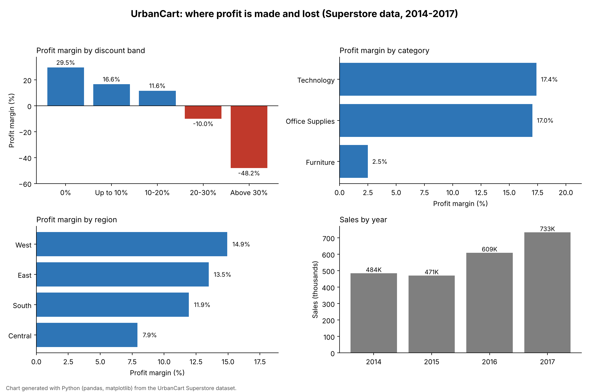

# UrbanCart Sales & Profitability Analysis

SQL, Excel and Power BI analysis of retail sales and profit, built on the public Superstore sample dataset (2014-2017). The goal is to find where the business makes and loses money, and what drives it.

## Dataset

- 9,994 order lines, 5,009 orders, 793 customers, 1,862 products
- 3 categories, 17 sub-categories, 4 regions, 49 states
- Order dates from 3 Jan 2014 to 30 Dec 2017
- Quality checks: no missing values, no negative delivery times; 1 duplicate row (ignoring Row ID); 519 same-day deliveries

## Key findings

| Metric | Value |
|---|---|
| Total sales | 2,297,201 |
| Total profit | 286,397 |
| Overall profit margin (profit / sales) | 12.47% |
| Average order value (sales / distinct orders) | 458.61 |
| Average discount | 15.6% |
| Average delivery time | 3.96 days |

**1. Discounts above 20% destroy profit**

| Discount band | Order lines | Profit margin | Share of lines losing money |
|---|---|---|---|
| 0% | 4,798 | +29.5% | 0.0% |
| Up to 10% | 94 | +16.6% | 4.3% |
| 10-20% | 3,709 | +11.6% | 14.0% |
| 20-30% | 227 | -10.0% | 91.6% |
| Above 30% | 1,166 | -48.2% | 97.8% |

Overall, 1,871 order lines (18.7%) lost money, a combined loss of 156,131.

**2. Furniture is the weak category**

| Category | Sales | Profit | Margin |
|---|---|---|---|
| Technology | 836,154 (36.4%) | 145,455 | 17.4% |
| Furniture | 741,999 (32.3%) | 18,451 | 2.5% |
| Office Supplies | 719,047 (31.3%) | 122,491 | 17.0% |

Three sub-categories lose money overall: Tables (-8.6% margin, -17,725 profit), Bookcases (-3.0%) and Supplies (-2.6%).

**3. Central is the lowest-margin region**

| Region | Sales | Profit | Margin |
|---|---|---|---|
| West | 725,458 | 108,418 | 14.9% |
| East | 678,781 | 91,523 | 13.5% |
| South | 391,722 | 46,749 | 11.9% |
| Central | 501,240 | 39,706 | 7.9% |

**4. Growth and seasonality**

| Year | Sales | Year-on-year | Margin |
|---|---|---|---|
| 2014 | 484,248 | - | 10.2% |
| 2015 | 470,533 | -2.8% | 13.1% |
| 2016 | 609,206 | +29.5% | 13.4% |
| 2017 | 733,215 | +20.4% | 12.7% |

September, November and December are the three strongest months in every year, and September to December together make up 50-54% of each year's sales. The best single month was November 2017 (118,448).

**Recommendations**

- Cap discounts at 20%; deeper discounts were loss-making on 92-98% of order lines.
- Review pricing and discounting for Tables and Bookcases.
- Investigate why the Central region earns about half the margin of West.

## Project contents

- `UrbanCart Superstore Dataset.xlsx`: raw data
- `UrbanCart_SQL_Case_Study/`: SQL case studies covering setup, KPIs, monthly trend, category profitability, region analysis and discount impact
- `excel_urbancart/`: Excel dashboard
- `powerbi_dashboard_urbancart/`: Power BI dashboard and its source data

## Limitations

- The discount analysis is descriptive. It shows that heavily discounted lines lose money, not that discounts alone are the cause.
- No statistical significance tests were run.
- A single public dataset; results do not generalise to other businesses.
- Currency is not stated in the dataset, so values are shown without a symbol.
